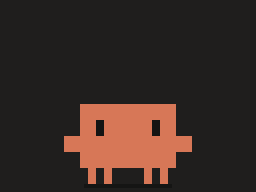
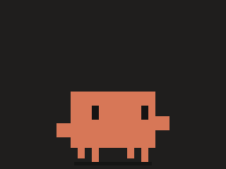
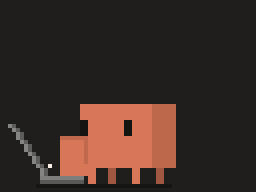
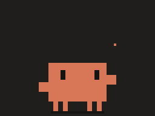
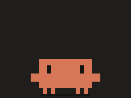
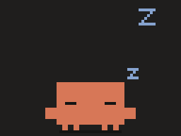
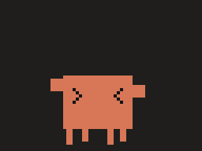
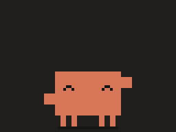

# ClawdPet — Claude Code 的 Clawd 像素桌宠

Windows 桌面宠物。Clawd 站在任务栏上走来走去、眨眼、思考（头顶是 Claude Code 的 ✻ spinner）、掏出笔记本敲代码、打瞌睡；可以点它、拖它、把它甩出去。

| 待机 | 走路 | 敲代码 | 思考 |
| :---: | :---: | :---: | :---: |
|  |  |  |  |
| **开心** | **睡觉** | **被拎起来** | **挥手** |
|  |  |  |  |

> 非官方粉丝作品，与 Anthropic 无关。Clawd、Claude 及 Claude Code 相关名称与形象归 Anthropic 所有。

- **一张像素图**：整个角色（包括笔记本、Zzz、爱心等特效）都画在同一张精灵图 `clawd.png` 里，逐帧播放，运行时不拆部件、不做补间。放大只用整数倍最近邻，像素始终是清晰的方块。
- **还原原版**：比例取自 Claude Code 欢迎界面的 Clawd（`▐▛███▜▌` 象限块字符画）：身体 12×4、眼睛 1×1 个字符象限，换算成方形像素后放大 2 倍即身体 24×16、眼睛 2×4、手 4×4、腿 2×4，颜色 `rgb(215,119,87)`。图标就是 1:1 的原版 16×10 Clawd。敲电脑动作按 Claude 应用里的样子画：Clawd 转成 3/4 侧身（右侧面深一号）、左手搭在键盘上，电脑在左侧只露出侧面的屏幕线，不遮挡身体。

## 下载

到 [Releases](https://github.com/FoOcean/ClawdPet/releases) 下载，解压后运行 `ClawdPet.exe`（Windows 10/11 x64）：

- `ClawdPet-<版本>-win-x64.zip`：自带运行时，解压即用。
- `ClawdPet-<版本>-win-x64-net10.zip`：体积小，需要先装 [.NET 10 桌面运行时](https://dotnet.microsoft.com/download/dotnet/10.0)。

从源码运行：

```bash
dotnet run --project src/ClawdPet
```

| 操作 | 效果 |
| --- | --- |
| 单击 | 开心地跳一下（睡觉时点它会醒；敲代码时点它会收起电脑再跳） |
| 拖动 | 拎起来，腿在空中晃；松手会按甩出的速度飞出去、撞墙反弹、落地压扁 |
| 右键 / 托盘右键 | 动作、大小（1×–8×）、皮肤、自由活动、总在最前、开机启动、召回、隐藏、重新加载皮肤、退出 |
| 托盘双击 | 召回到鼠标所在屏幕 |

## 命令行 / 遥控

已经在运行时，再次调用 `ClawdPet.exe <命令>` 会通过命名管道（仅当前用户）把命令交给正在运行的桌宠并打印回复，约 0.2 秒返回；没在运行时会在后台启动一个再执行该命令。

```bash
ClawdPet.exe work          # 掏出电脑敲代码，直到下一条命令（work 30 = 敲 30 秒）
ClawdPet.exe think         # 盯着头顶的 ✻ 思考
ClawdPet.exe done          # 收起手头的事，然后开心地跳一下
ClawdPet.exe attention     # 头顶冒 "!"，然后挥手
ClawdPet.exe sleep | wake | wave | happy | walk left | look
ClawdPet.exe play typing 5 # 播放精灵图里任意动画标签（给秒数则循环）
ClawdPet.exe status | summon | scale 4 | reload | quit
```

### 接入 Claude Code

在 Claude Code 的 `settings.json` 里加 hooks，Clawd 就会跟着 Claude 干活（路径换成你的）：

```json
{
  "hooks": {
    "UserPromptSubmit": [{ "hooks": [{ "type": "command", "command": "\"C:/path/to/ClawdPet.exe\" work" }] }],
    "Stop":             [{ "hooks": [{ "type": "command", "command": "\"C:/path/to/ClawdPet.exe\" done" }] }],
    "Notification":     [{ "hooks": [{ "type": "command", "command": "\"C:/path/to/ClawdPet.exe\" attention" }] }]
  }
}
```

## 结构

```
tools/SpriteGen/          精灵图生成器：按姿势参数逐帧画出整张 clawd.png + 图集 JSON + 图标 + 预览
  ClawdAnimations.cs        ← 所有动画的帧、时长、特效（美术在这里改）
  Clawd.cs                  画师：正面 / 3/4 侧身 Clawd、笔记本、字形
src/ClawdPet.Core/        与 UI 无关的桌宠引擎（可单测，可移植到别的 UI）
  Sprites/SpriteAtlas.cs    读 Aseprite 格式的图集（frames + frameTags + "anchor" 切片的 pivot = 脚底点）
  Animation/Animator.cs     按每帧自己的时长播放；FrameEntered / Completed 事件
  Behaviors/                行为状态机：PetBrain 一次只跑一个 PetBehavior
    Builtin/                idle / walk / work / think / sleep / drag / fall / 通用 ClipBehavior …
  PetCommands.cs            文本命令 → 行为
src/ClawdPet/             WPF 宿主：透明置顶窗口、整数倍放大、拖拽、菜单、托盘、单实例 + 命名管道
  Assets/Skins/clawd/       clawd.png + clawd.json（唯一的角色图）
tests/ClawdPet.Core.Tests/ 引擎测试（用真实精灵图）
```

行走是"踩帧移动"：每出现一帧走路帧就整像素地挪一步，所以是像素游戏那种一步一步的走，而不是平滑滑动。

## 扩展

**加一个动画**（两种方式，都只改那一张图）

1. 在 `tools/SpriteGen/ClawdAnimations.cs` 里加一行 `new("dance", Dance())` 并写出帧，然后
   `dotnet run --project tools/SpriteGen` 重新生成 `clawd.png / clawd.json`，打开 `artifacts/sprite-preview/preview.html` 看效果。
2. 或者用 Aseprite 直接画：导出 Sprite Sheet 时选 JSON Data（Array 或 Hash）、勾选 Tags 和 Slices；加一个名为 `anchor` 的切片，pivot 放在脚底中点。

新标签不用写代码就能播放：右键 → 动作 → 全部动画，或 `ClawdPet.exe play dance`。

**加一个行为**：继承 `PetBehavior`，在 `OnEnter` 里 `Play(...)`，结束时 `Complete()`；可重写 `OnFrame`（按帧移动）、`OnClipCompleted`（串联阶段）、`OnInput`（点击/拖拽）、`OnFinishRequested`（优雅收尾）。然后在 `BuiltinBehaviors.CreateRegistry()` 里注册：

```csharp
.Register(new("dance", () => new ClipBehavior("dance"))
{
    MenuLabel = "跳舞",          // 出现在右键菜单
    AutoWeight = _ => 1,         // 自由活动时被随机选中的权重
    Aliases = ["party"],         // 命令别名
})
```

**换皮肤**：把 `<名字>\<名字>.json + .png` 放到 `%APPDATA%\ClawdPet\skins\`，右键菜单会出现"皮肤"。

**接入别的程序**：任何能写命名管道或调用命令行的东西（脚本、IDE 插件、CI 通知）都能用上面的命令驱动它。

## 开发

```bash
dotnet run --project tools/SpriteGen     # 重新生成精灵图、图标、预览
dotnet test tests/ClawdPet.Core.Tests    # 引擎测试
```

设置 `CLAWDPET_HOME=<目录>` 可以把配置、日志、单实例锁都隔离到别的目录，测试实例不会碰你正在用的桌宠和开机启动项。数据默认在 `%APPDATA%\ClawdPet`（`settings.json`、`clawdpet.log`）。

后续可做：坐在窗口标题栏上、全屏时自动隐藏、跟随鼠标、气泡对话、更多皮肤（帽子、节日装）。
